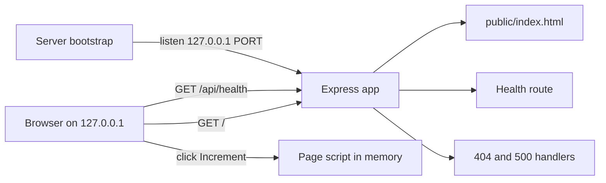

# Design: Wave Merge Test

## Overview

Wave Merge Test is a small local Node.js/Express app used by one developer/tester to check that Greenfield builds an app in waves, merges each wave automatically, and recovers when a wave conflicts with a manual commit on local main. The app itself is deliberately tiny: one page at `/` with the heading "Wave Merge Test" and a counter, and one JSON endpoint at `/api/health`. It stores nothing, has no sign-in, no database and no external integrations, and it answers only on 127.0.0.1.

The app implements no branching, merging, rebasing or conflict recovery. Those are Greenfield build configuration (requirements 1.6 and the brief's BR2), so nothing in this design touches git.

## Architecture

Three layers, all in one Node.js process:

1. **Server bootstrap** — reads `process.env.PORT` (default `3000`), binds to `127.0.0.1`, and prints a plain error and exits when the port is taken.
2. **Express app** — serves the static home page, the health route, and the 404/500 handlers. It is built by a factory so tests can mount it without binding a port.
3. **Browser script** — plain JavaScript in the page that holds the counter in memory and updates the DOM on click.



No request ever carries the counter value: the page script keeps it in a local variable, so a refresh starts again at 0 (criterion 1.5, 1.6).

## Build and run

Install: npm install
Test: npm test
Run locally: yes
Dev: npm run dev
Port variable: PORT
Health path: /api/health
Deploy: none

`npm run dev` starts `src/server.js` with Node's built-in `--watch` flag, so no extra dev dependency is needed. `npm test` runs `node --test` once and exits. Neither command fixes a port: both read `PORT`, and the tests set it to a free port they pick.

## Components and Interfaces

### `src/app.js` — `createApp()`

Exports a factory that returns a configured Express app without listening. It:

- serves `public/` as static files, with `index.html` answering `GET /` (criteria 1.1, 1.2);
- mounts the health router at `/api/health` (criteria 2.1–2.3);
- ends with a 404 handler that sends `404` and a plain text body (criterion 5.1);
- ends with an error handler that sends `500` and a plain text body (criterion 5.2).

The factory takes no arguments and reads no environment variables, so a test can mount it directly.

### `src/routes/health.js` — health router

A single `GET /` handler on an `express.Router()` that answers `200` with `res.json({ status: 'ok' })`. `res.json` sets `Content-Type: application/json` and writes exactly `{"status":"ok"}` with no other keys (criteria 2.1–2.3).

### `src/server.js` — bootstrap

```js
const port = Number(process.env.PORT) || 3000;
const server = app.listen(port, '127.0.0.1', () => { /* print the URL */ });
server.on('error', (err) => {
  if (err.code === 'EADDRINUSE') { console.error(`Port ${port} is already in use.`); process.exit(1); }
  throw err;
});
```

- `PORT` set → that port (criterion 3.2); unset or empty → `3000` (criterion 3.3).
- The host is the literal `127.0.0.1`, so the socket is not reachable from another address (criteria 3.1, 3.4).
- A taken port prints one plain sentence and exits with a non-zero code (criterion 3.5).

### `public/index.html` — home page

One static HTML file with an inline `<style>` and an inline `<script>`. It holds:

- the masthead wordmark and the `<h1>Wave Merge Test</h1>` (criterion 1.1);
- a counter element with `id="counter"`, `role="status"`, `aria-live="polite"`, starting at the text `0` (criterion 1.2);
- a `<button id="increment" type="button">Increment</button>` (criterion 1.7);
- a short health note showing `GET /api/health` and `{"status":"ok"}`, and a "How to run" note naming `npm run dev` and the `PORT` fallback.

The script keeps `let value = 0` in a closure, adds 1 on the button's `click`, and writes the new value into `#counter`. Nothing is sent to the server and nothing is stored (criterion 1.6). A native `<button>` is focusable and fires on `Enter` and `Space`, so the counter works with the keyboard alone (criterion 1.8). A `+`/`=` key handler on the document also increments, except while a button has focus.

### `public/styles.css` — page styles

The page's own stylesheet, linked from `index.html`. It defines the colour and font custom properties from the approved mock-up as `:root` variables and styles the masthead, the heading, the counter panel, the primary and quiet buttons, the health note, the footer and the focus ring. It is a separate file so the page's styles never collide with anything else in the repository.

### `test/` — tests

`node --test` discovers `test/**/*.test.js`. Each test file starts the app on a free port it picks (`server.listen(0, '127.0.0.1')`), reads the port from `server.address().port`, and closes the server afterwards, so a running `npm run dev` never blocks the run (criterion 6.1).

| Test file | What it checks | Criteria |
| --- | --- | --- |
| `test/health.test.js` | status 200, `Content-Type: application/json`, body exactly `{"status":"ok"}` | 2.1, 2.2, 2.3, 6.4 |
| `test/home.test.js` | `/` answers 200 with the heading "Wave Merge Test" and a counter at 0 | 1.1, 1.2, 6.2 |
| `test/counter.test.js` | the page script increments by 1 per click, three clicks give 3, a fresh load gives 0 | 1.3, 1.4, 1.5, 6.3 |
| `test/errors.test.js` | unknown path gives 404 plain text; a thrown route gives 500 plain text | 5.1, 5.2 |
| `test/server.test.js` | `PORT` is honoured, unset falls back to 3000, host is 127.0.0.1, a taken port exits | 3.1–3.5 |
| `test/performance.test.js` | `/` and `/api/health` answer within 1 second | 4.1, 4.2 |

The counter test loads `public/index.html` into a minimal DOM (a tiny hand-written stub of `document.getElementById`, `addEventListener` and `textContent`, no extra dependency) and runs the page script, so it checks the real script rather than a copy of it.

## Data Models

There is no database and no stored record. The only data is the counter:

| Field | Type | Starts at | Held in | Kept for |
| --- | --- | --- | --- | --- |
| `value` | number | `0` | a variable in the page script | until the page is refreshed |

The health answer is a fixed object, `{ status: 'ok' }`, built on each request.

## Error Handling

- **Unknown path** — the 404 handler answers `404` with `Content-Type: text/plain` and one short sentence, such as `Not found.` (criterion 5.1).
- **Failure inside a route** — the Express error handler answers `500` with `Content-Type: text/plain` and one short sentence, such as `Something went wrong.`, and logs the error to the terminal (criterion 5.2).
- **Port in use** — the server's `error` event prints `Port <n> is already in use.` and exits with code 1 (criterion 3.5).
- **Missing dependency** — `npm install` is the only setup step; a missing module fails at startup with Node's own message, which is the plain terminal error the brief's A2 asks for.

No error answer is HTML, and nothing retries.

## Testing Strategy

- **Unit and integration tests** with `node --test`, run by `npm test`. Each file starts the app on port `0` so the operating system picks a free port; nothing reads `.env` and nothing needs a service.
- **HTTP checks** use Node's built-in `fetch` against the started server, asserting status, headers and the exact body string.
- **Page checks** read `public/index.html` for the heading, the button label and the counter's initial value, and run the page script against a small DOM stub for the click behaviour.
- **Timing checks** measure one request to `/` and one to `/api/health` and assert each finishes under 1000 ms.
- **End-to-end journeys** are saved by Greenfield's Tester in `e2e/` with `@playwright/test`; the unit runner leaves that folder out, since those tests need the running app.

## Correctness Properties

### Property P1: The counter counts clicks
For any sequence of clicks on the increment button where the page has not been reloaded, the counter shows the number of clicks.
- _Validates: 1.3, 1.4_
- _Kind: invariant_

### Property P2: A fresh page starts at zero
For any number of clicks before a reload, the page after the reload shows the counter at 0.
- _Validates: 1.2, 1.5_
- _Kind: transition_

### Property P3: The health answer is always the same
For any request to `/api/health`, the answer is status 200, `Content-Type: application/json`, and the body `{"status":"ok"}`.
- _Validates: 2.1, 2.2, 2.3_
- _Kind: invariant_

### Property P4: The port comes from the environment
For any valid port number set in `PORT`, the server listens on that port; when `PORT` is unset, it listens on 3000.
- _Validates: 3.2, 3.3_
- _Kind: oracle_

### Property P5: Unknown paths are plain 404s
For any path the app does not serve, the answer is status 404 with a plain text body.
- _Validates: 5.1_
- _Kind: error_

### Property P6: The counter never leaves the page
For any sequence of clicks, no request sent by the page carries the counter value.
- _Validates: 1.6_
- _Kind: invariant_
- _Not property-testable: the page script sends no requests at all, so there is no generated input to vary; an example test asserts that the script contains no `fetch`, `XMLHttpRequest` or `localStorage` call._

## Assumptions

- The page is one static HTML file with inline style and script, plus a linked stylesheet, served by Express's static middleware; there is no template engine and no build step.
- `npm run dev` uses Node's `--watch` flag, so the app has one runtime dependency (`express`) and no dev-only tooling beyond `@playwright/test`.
- The counter test uses a small hand-written DOM stub rather than a DOM library, keeping the dependency list to `express` and `@playwright/test`.
- The 404 and 500 bodies are short English sentences in plain text, as the requirements' assumptions state.
- The reset button in the mock-up is kept as a quiet secondary action; it sets the counter back to 0 and is not required by any criterion.

## Look and feel

The approved mock-ups: `agent_generated/ui-preview/home.html`. Their colours and font are in `.nexgile/greenfield/tokens.json`; build the screens with them.

- Font: Georgia, 'Iowan Old Style', 'Times New Roman', serif
- Colours:
  - primary: `#b45309`
  - primary-hover: `#92400e`
  - on-primary: `#fffbeb`
  - background: `#faf7f2`
  - surface: `#fffdf9`
  - surface-variant: `#f3ede3`
  - text: `#1c1917`
  - text-muted: `#78716c`
  - outline: `#e7dfd2`
  - outline-strong: `#d6cbb9`
  - accent: `#0f766e`
  - accent-tint: `#e6f4f1`
  - focus-ring: `rgba(180, 83, 9, 0.3)`
